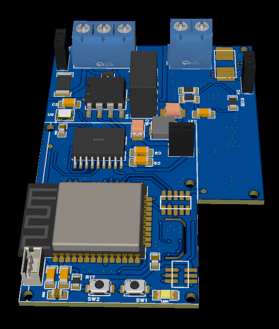
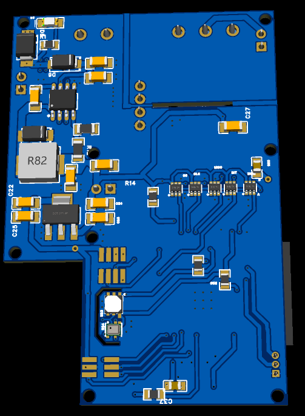

# Nmea-2000-Main-PCB-esp32-(On going)

Project of a Serie of Hats Sensors link to Main pcb esp32 iso Can 

1 NMEA 2000 GPS Hat all included in pro antenna.\
2 NMEA 2000 Tilt Compass Hat build with mpu6050 + LSM303DLHC.\
3 Battery Monitor Hat.

Main Pcb esp32 iso nmea2000

|

